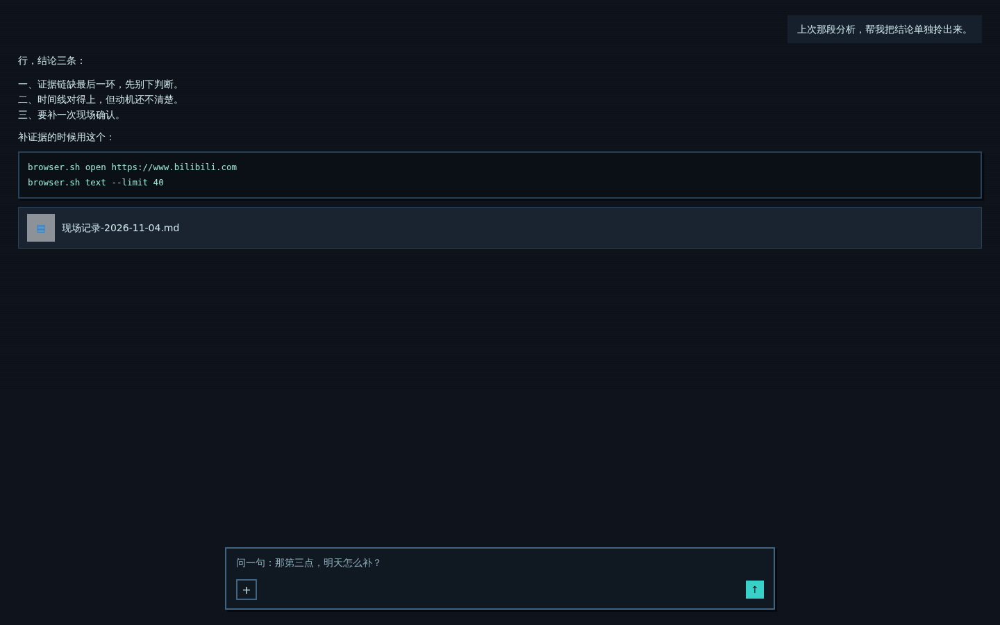

# dsh-pixel-crt

A dark CRT pixel skin for the conversation pane of the DSH Web GUI — hard 2px borders, block shadows, bitmap headings, scanlines. Scoped to the chat and composer regions only; the sidebar, title bar and other panels are untouched.



> The screenshot is a demo render of the skin on a mock conversation, not a capture of a live session.

## What it does

- Redefines the palette inside `[data-conversation-region="chat"]` and `[data-conversation-region="composer"]`: near-black surfaces, cyan accents, zero border radius. Components that read the `--dsw-alias-*` variables follow automatically.
- Adds the pixel furniture: 2px borders, `3px 3px 0` block shadows, pressed-state offset, flat code blocks, square scrollbars, cyan caret, pixel selection.
- Headings and buttons use a bitmap face (`Unifont` / `Zpix` / `WenQuanYi Zen Hei Sharp`, whichever is installed). Body text stays at the normal 14px and keeps the system font — bitmap faces at small sizes just turn to mush.
- Slight scanline overlay via a repeating gradient.

## What it does not do

- It does not touch the sidebar or any panel outside the conversation.
- It does not change message layout, spacing or font size. Nothing moves; only the skin changes.
- It is a pure front-end bundle: no host routes, no config, no state, nothing written to disk.

## Install

```sh
dsh plugin add <this-repo-url>
```

or point the plugin manager at a checkout:

```sh
dsh plugin install ./pixel-crt
```

Then reload the Web GUI. Uninstall by disabling or removing the `dsh-pixel-crt` bundle.

## Why a contrast sweep

Some components hard-code their surfaces in local variables (`--deliverable-fill`) or `color-mix(#fff 50%, transparent)` instead of the alias tokens, so a dark palette leaves light cards with light text — usually a file name you can't read. The bundle runs a small, debounced sweep after each render: if an element sits on a light background *and* its text is light, the background is pushed dark. Dark surfaces and dark-on-light cards are never touched.

## Known rough edges

- Small icon-only buttons look chunky at 2px.
- All headings collapse to one size (16px) — the bitmap face only reads cleanly on a 12/16px grid.
- Scanlines are one CSS rule; delete the `background-image` line if you don't want them.

## License

MIT
